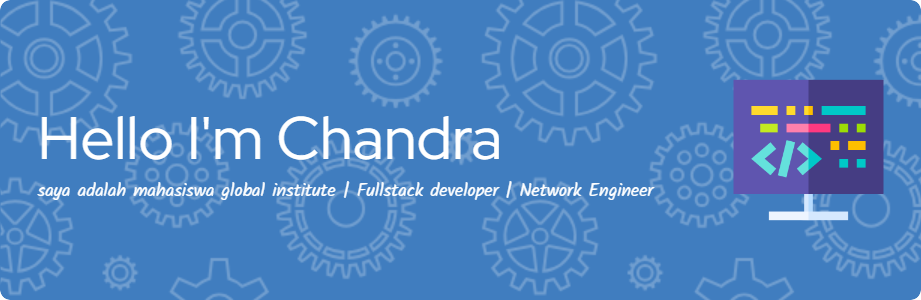

<div align="center">



# Hi there, I'm Chandra! 👋

### 💻 Web Developer | 🌐 Networking | 🤖 IoT Enthusiast


<br>


</div>

---

## 👨‍💻 About Me

```javascript
const chandra = {
  interests: [
    "Web Development",
    "Internet of Things",
    "Artificial Intelligence",
    "Computer Networking"
  ],
  currentlyLearning: [
    "Laravel",
    "ESP32",
    "AI & Computer Vision"
  ],
  motto: "Keep learning, keep building!"
};
```

- 🎓 Studying Computer Networking
- 🌱 Currently learning **Laravel & IoT**
- 🔭 Building web applications and ESP32 projects
- 🤖 Interested in AI and Smart Technology
- ⚡ Fun fact: Suka coding meskipun kuliah di jurusan Jaringan Komputer!

---

## 🛠️ Tech Stack

<div align="center">

### 🌐 Web Development


### 🤖 Programming & IoT


### ⚙️ Tools & Platforms


</div>

---

## 🚀 Featured Projects

| Project | Description | Technologies |
|---------|-------------|--------------|
| 🕶️ Smart Glasses | Smart glasses for obstacle detection and navigation assistance | ESP32-CAM, ToF, AI |
| 🌱 Smart Farming | IoT-based automated watering and monitoring system | ESP32, MQTT |
| 🛍️ UMKM Finder | Web platform for discovering local businesses | Laravel, MySQL |
| 🧵 Sistem Jahit | Tailoring management and transaction system | PHP, MySQL |

---

## 📊 GitHub Statistics

<div align="center">


</div>

---

## 📈 Contribution Activity

<div align="center">


</div>

---

## 🕹️ Pac-Man Contribution Graph

<div align="center">

<picture>
  <source media="(prefers-color-scheme: dark)" srcset="https://raw.githubusercontent.com/chanjr227/chanjr227/output/pacman-contribution-graph-dark.svg">
  <source media="(prefers-color-scheme: light)" srcset="https://raw.githubusercontent.com/chanjr227/chanjr227/output/pacman-contribution-graph.svg">
  
</picture>

</div>

---

## 🌐 Connect With Me

<div align="center">

<a href="https://instagram.com/chanjr227">
  
</a>

<a href="https://github.com/chanjr227">
  
</a>

</div>

---

<div align="center">

### ✨ "Code. Learn. Build. Repeat."

⭐ Thanks for visiting my GitHub profile!

</div>
